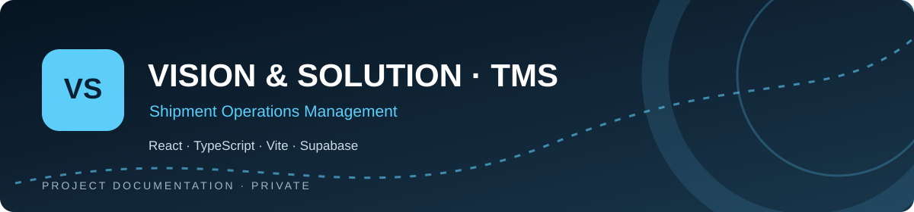

<div align="center">



# VISION & SOLUTION · TMS

**Bilingual shipment operations management**

  

[**Repository overview ↗**](https://github.com/a7mdel5taeeb-eng/vision-solution-shipment-system) · [**Architecture ↓**](#-architecture-at-a-glance) · [**Project notes ↓**](#-original-project-documentation)

</div>

---

## ✨ Overview · نبذة عن المشروع

**Private work-in-progress system**

Production deployment is NOT configured in the documented baseline. Demo Mode is browser-local; Connected Mode is opt-in against local Supabase. Refer to docs/PROJECT_STATUS.md for authoritative implementation state, verified steps and pending work.

| | Focus area |
|:--:|:--|
| 🧭 | Admin/employee roles |
| 🧩 | Shipment workflows |
| 🌐 | Demo Mode |
| ⚙️ | Connected Mode |

**Core stack:** React · TypeScript · Vite · Local Supabase

## 🧠 Architecture at a glance


*Conceptual project map — not a claim of production deployment or complete infrastructure.*

## 📂 Repository map

`src/` · `supabase/` · `tests/` · `docs/PROJECT_STATUS.md` · `AGENTS.md`

## 🛡️ Working principles

- Preserve existing working functionality and keep application changes separate from documentation updates.
- Run the relevant project checks before merging application changes.
- Do not commit credentials, private customer/school data, or local environment files.
- Validate bilingual layouts, accessibility and mobile behavior where applicable.
- Never assume the app has been deployed: follow the checkpoint in `docs/PROJECT_STATUS.md`.

---

## 📚 Original project documentation

The established README content below is intentionally preserved, including the project's setup instructions, detailed notes, and historical checkpoints.

---

# Vision & Solution Shipment Management System

**Approved frontend baseline: Phase 2.9 — Accessibility Fixes & UI Hardening · v0.2.0**

A bilingual, responsive shipment operations workspace built on the existing Phase 1 foundation. All people, customers, trucks and shipments in the seeded dataset are fictional. Demo Mode keeps shipment operations in browser-local storage. A separate opt-in Connected Mode now verifies sessions against local Supabase Auth; no cloud project, external email service, DNS or hosting is connected.

**Source repository:** [a7mdel5taeeb-eng/vision-solution-shipment-system](https://github.com/a7mdel5taeeb-eng/vision-solution-shipment-system) · Private · Default branch: `main`.

The application is a separate project from the company's public marketing website. The future product address is `system.vsolutions.co`; it has not been deployed.

For the current approved phase, pending PRs, computer readiness and verified checkpoints, read [PROJECT_STATUS.md](docs/PROJECT_STATUS.md). Follow the [HOME/SCHOOL workflow](docs/cross-computer-workflow.md) before and after every approved session. Phase 3C.5 is approved/merged at main `ed4b8f0649b7e05e7c9f69865ee740529f85094d`. The current Connected-only mobile readability candidate is isolated in existing Draft PR #15; see its [implementation and actual HOME verification](docs/mobile-first-connected-ui-verification.md). Owner visual approval is pending.

## Current local connected application

Phase 3C.5 completes live dashboard/report workflows on the merged shipment command foundation. Operational statistics and overdue drilldowns use server-authoritative status; reports offer RLS-scoped search, status, owner and inclusive Riyadh date filters, pagination and bounded spreadsheet-text CSV export. Employees see only owned records; administrator operations require real AAL2. Daily reporting is an administrator-only prior-Riyadh-calendar-day **preview**, with the intended 08:00 time explicitly labeled: nothing is scheduled or sent. Default Demo Mode and its browser records/workflows remain separate and unchanged. See [the workflow acceptance runbook](docs/phase-3c5-connected-workflow-acceptance.md), [commands](docs/phase-3c4-connected-shipment-commands.md) and [reads](docs/phase-3c3-connected-shipment-reads.md); older prototype descriptions below describe Demo Mode.

Run `npm run dev` for Demo at `http://127.0.0.1:5173/` and, with the existing approved local Supabase stack/public-client configuration, `npm run dev:connected` for `http://127.0.0.1:5174/workspace`. Connected reports are at `/reports`; administrator daily preview is at `/daily-report`. Never put service credentials in Vite variables. The sixth forward-only local migration `20261028210000` adds only a bounded invoker report function. Verify a private backup and inspect pending migrations before `npx supabase migration up --local`; never reset a populated database. Invoice image uploads, email delivery/scheduling, production services, deployment, later phases and merging PR #15 remain outside scope. Pending command recovery and one unsaved draft are account-bound in tab sessionStorage, survive reload and clear at logout; they do not synchronize across computers. CSV is capped at 1,000 matching rows and prefixes every field as spreadsheet text; no partial file is downloaded above the cap.

## Phase 3C.1 local authentication checkpoint

Phase 3C.1 is approved and merged into main at `c9c15347d5fc95075ade8438311479b3cb07ac0c`. Demo Mode remains the default and existing shipment workflows remain browser-local. `npm run dev:connected` opens a separate local preview on 5174; no cloud project or production service is used.

Local email/password login, session restoration/refresh, protected navigation and logout are implemented and verified. The owner-approved HOME Auth-only repair enabled the email provider while retaining disabled public signup, anonymous sign-in and SMTP. All 13 real Auth tests passed, alongside 41 application, 20 database and 20 workflow tests. English desktop and Arabic mobile browser flows passed. See the [local Auth setup and actual test report](docs/phase-3c1-auth-sessions.md) and [central status](docs/PROJECT_STATUS.md).

The original unprovisioned Auth-only fixture remains local; its previously exposed fictional password was rotated and refresh sessions revoked. Use `npm run auth:fixture` only when that fixture and connected configuration do not already exist. Keep private CLI keys, passwords and environment/runtime files out of Git.

## Historical Phase 3C.2 protected accounts and MFA checkpoint

The existing `feature/phase-3c2-secure-accounts-mfa` branch / draft PR #10 adds trusted fictional local Admin/Employee provisioning, self-only protected profile/role lookup, administrator TOTP enrollment/verification and bilingual role-aware account screens. Real signed-HTTP tests verify employee isolation, inactive/unauthorized denial, metadata-forgery resistance and administrator AAL1/AAL2 boundaries. Demo role selection cannot grant connected permissions.

See the [Phase 3C.2 setup and historical security tests](docs/phase-3c2-secure-accounts-mfa.md). HOME already has three fictional local accounts; credentials remain only in ignored `local-data/phase3c2-accounts.local.json`. The bootstrap refuses existing files; do not overwrite accounts or factors. PR #10 was approved and merged; its original scope excluded shipment integration. Account-management/recovery UI, public signup and production services remain excluded.

## Technology stack

| Area                     | Technology                                                           |
| ------------------------ | -------------------------------------------------------------------- |
| Application              | React 19, TypeScript 6, Vite 8                                       |
| Interface                | Tailwind CSS 4, semantic CSS tokens, Lucide icons                    |
| Navigation               | React Router 7                                                       |
| Languages and typography | Typed Arabic/English catalogs, RTL/LTR, local Montserrat/Cairo fonts |
| Demo persistence         | Versioned browser localStorage and tab-local demo entry              |
| Quality checks           | Node built-in test runner, strict TypeScript, Oxlint, Prettier       |

## Open locally

Requirements: Git, Node.js 22.12+ (24 LTS recommended), npm 10+, and an authenticated GitHub account with access to this private repository.

```sh
git clone https://github.com/a7mdel5taeeb-eng/vision-solution-shipment-system.git
cd vision-solution-shipment-system
npm ci
npm run dev -- --host 0.0.0.0
```

Open [http://127.0.0.1:5173/](http://127.0.0.1:5173/), then select an administrator or employee demo account. The commands work in PowerShell, macOS and Linux shells. Authenticate private Git access through Git Credential Manager or GitHub CLI (`gh auth login`) when needed. No environment file, API key, company credential or backend setup is required.

For an existing checkout, start from `npm ci`. If this project's server is already running, open the URL instead of starting a second server. Vite uses `strictPort`, so an occupied port produces an explicit error. Stop a server you started with Ctrl+C.

Cloning installs the source and fictional seed data. Existing browser-local shipment records are not uploaded to GitHub or transferred between computers. Dependencies, builds, environment files, credentials, operational exports and local QA artifacts are excluded by `.gitignore`.

To view the local production bundle:

```sh
npm run build
npm run preview
```

Open [http://127.0.0.1:4173/](http://127.0.0.1:4173/). The development command above binds to all local interfaces as requested for the preview; the default config and production preview bind to loopback. Building and previewing do not deploy anything. The future application address `system.vsolutions.co` is informational; no domain or production configuration has been changed.

## Branch workflow and working from another computer

GitHub is the project’s source of truth. `main` is the stable, approved baseline; each development phase uses a dedicated feature branch and is merged only with explicit approval. Before any work, inspect the current checkout and changes, then fetch the remote state:

```sh
git status --short --branch
git fetch origin --prune
git branch --show-current
```

Never discard or overwrite uncommitted changes. For a new phase, start from the current approved remote `main` and create a focused branch, for example `git switch -c qa-performance-phase-2.7 origin/main`. Run `npm run check`, review for accidental secrets or generated files, commit the verified work, push with `git push -u origin <branch>`, and confirm it appears on GitHub. Do not merge or force-push `main` without explicit approval.

To continue on another Windows computer, first finish transferable work on the current machine with a reviewed commit and push. On the other machine, clone if needed, authenticate to GitHub, fetch, and switch to the branch:

```powershell
git clone https://github.com/a7mdel5taeeb-eng/vision-solution-shipment-system.git
cd vision-solution-shipment-system
git fetch origin --prune
git switch <branch>
git pull --ff-only origin <branch>
npm ci
npm run dev -- --host 0.0.0.0
```

If `git pull --ff-only` refuses because local commits differ, do not force a resolution: inspect `git status`, commit or stash only work you intend to keep, then reconcile deliberately. Browser-local prototype data is intentionally not synchronized by GitHub; only committed source, documentation, and tests transfer between computers.

## Impeccable on the home and school computers

After cloning/synchronizing this branch and running `npm ci`, run the project setup from PowerShell:

```powershell
.\scripts\setup-impeccable.ps1
.\scripts\setup-impeccable.ps1 -CheckOnly
```

The script finds the repository relative to its own location, checks Git, Node.js 22.12+ and npm 10+, and installs only the Codex project skill. It pins **skill 4.8.0**, **npm launcher 4.8.0**, **engine 0.1.18**, and the SHA-256 of the official `skill-v4.8.0` bundle in `.impeccable/toolchain.json`. Pinning npm alone is insufficient: the official installer normally fetches the current skill bundle. Our script supplies the verified release archive through its supported `IMPECCABLE_BUNDLE_PATH` input. No application dependency is added.

Existing installations are verified and preserved. A different version, incomplete installation, failed download, or checksum mismatch stops setup instead of forcing a replacement. The official hook command merges provider manifests. `-CheckOnly` verifies the existing installation without changing it; `-SkipHooks` installs/verifies the skill without enabling provider hooks. The first engine run may need access to GitHub for its verified native binary. Node/npm and Codex must be installed separately on each Windows computer.

Open/reopen this repository in Codex after setup. The skill should be available on the next turn; invoke `$impeccable audit` or `$impeccable polish <target>` when that work is approved. Approve the project hook in Codex through `/hooks` if that build requests trust. Installation consent and hook activation on one machine do not transfer to the other machine. If organizational PowerShell, proxy, or antivirus policy blocks setup, use the school's approved installation process; do not disable protections.

Shared GitHub files are `AGENTS.md`, `PRODUCT.md`, `.impeccable/config.json`, `.impeccable/toolchain.json`, and this setup script. `.agents/`, `.codex/`, release caches, live sessions, and `.impeccable/config.local.json` remain ignored and are regenerated locally. Do not copy credentials or absolute home-computer paths to the school computer. The default workflow is code-first; a future comp-first concept needs explicit approval. Do not run unpinned `impeccable update`; upgrade the version and digest together in a reviewed feature branch.

The native hook runs locally with the agent's permissions; Codex trust is still required where supported. It emits design feedback, and is not a security sandbox or production security audit. Setup preserves existing product context and approved UI. Manual scans remain available if the hook is unavailable in a particular Codex build:

```powershell
.\.agents\skills\impeccable\scripts\impeccable.cmd detect src --json
```

The Phase 2.8 clean-clone test found that the earlier GitHub lockfile omitted four optional transitive packages, causing npm 11.19.1 to reject `npm ci`. The preserved lockfile correction supplies those entries without changing declared dependencies or existing package versions. Stop the local dev server before running `npm ci` on Windows to avoid locked native-module files. See [the Phase 2.8 report](docs/phase-2.8-verification.md) for validation and the read-only design audit.

Official references: [Impeccable installation](https://impeccable.style/docs/), [skill 4.8.0 release](https://github.com/pbakaus/impeccable/releases/tag/skill-v4.8.0), [installer local-bundle support](https://github.com/pbakaus/impeccable/blob/skill-v4.8.0/crates/skills/src/bundle.rs), and [OpenAI skills documentation](https://learn.chatgpt.com/docs/build-skills).

## Try the two roles

Open `/` to see the account-selection landing page, then choose a named employee or administrator. No passwords or real accounts are involved. **Logout** returns to the landing page without removing shipment records. The selected demo entry survives refresh within the same tab; a fresh tab starts at account selection.

| Demo user        | Role          | Experience                                                                                                                         |
| ---------------- | ------------- | ---------------------------------------------------------------------------------------------------------------------------------- |
| Noura Al Salem   | Administrator | All shipments, creation/editing, completion/reopening, soft deletion/restoration, overdue alerts, reports, demo users and settings |
| Omar Al Harbi    | Employee      | Own shipments, creation/editing, completion/reopening, invoice information                                                         |
| Sara Al Nasser   | Employee      | A different employee's own shipment records                                                                                        |
| Faisal Al Rashid | Employee      | A third employee's own shipment records                                                                                            |

Employees have a simple header, a charcoal welcome banner with a cyan registration button, three statistics and personal shipment cards. Administrators have a sidebar, four statistics and a shipment table, which becomes cards on phones and smaller tablets. A compact drawer provides mobile navigation. Admin-only routes redirect to the dashboard for employees. Other employees' shipment IDs cannot be opened or edited within the prototype. These checks also run in the domain mutation layer. This is **prototype behavior, not production security**: all demo data lives in the browser and the role selector is intentionally unrestricted.

The identity uses the official company's unmodified VS PNG asset, extracted cyan `#00D4FF`, blue `#007BFF`, charcoal surfaces, and the official Arabic name **رؤى وحلول**. Montserrat and Cairo are bundled locally. The approved entry folio and role layouts are preserved. Arabic mirrors navigation using logical CSS properties. See [brand analysis and provenance](docs/phase-2.6-brand-analysis.md).

The employee dashboard uses a slim welcome strip and compact statistics so shipments appear earlier. Consignment cards emphasize customer names, labeled loading/unloading points, truck/driver details, start times and statuses. The administrator dashboard restores a **Priority desk** showing the three longest-overdue active shipments, with a link to all alerts. Admin navigation omits My Shipments; its existing route remains available for compatibility.

Main routes: `/` (account selection), `/dashboard`, `/shipments`, `/my-shipments`, `/shipments/new`, `/shipments/:id`, `/shipments/:id/edit`, `/alerts`, `/reports`, `/daily-report`, `/users`, `/settings`, and `/deleted-shipments`.

## Functional features

- **Operational dashboards:** compact branded welcome banners, real counts from local records, status filters, sorting and search. Employees use personal cards; administrators use the central register and three most urgent overdue shipments. Status distribution and the seven-day starts chart remain on Reports.
- **Shipment registration:** customer, loading/unloading locations, truck, driver and cargo are required. ID (`TR-0001` etc.), start timestamp and owner are recorded automatically. No manually entered start date is requested.
- **Driver phone:** optional telephone input beside Driver Name. Saudi/international formats, Arabic/Persian digits, formatting separators and optional extensions are supported. Main numbers use 7–15 digits; 00 prefixes and optional international trunk-zero notation are handled in safe `tel:` links. Values remain strings with entered formatting. The creator and administrators can edit; details and owner-scoped cards display the number. No SMS, WhatsApp or number verification is connected.
- **Editing and invoices:** shipment fields, invoice number, notes and an optional invoice image. PNG/JPEG/WebP images up to 750 KB are stored as local data URLs. SVG, PDF and larger files are rejected. Removing an image is supported.
- **Workflow:** the stored status is Pending or Completed. An open record is displayed as Overdue strictly after 96 hours. Completion requires a timestamp between start and now, entered in Asia/Riyadh time. Completed records can have their completion time edited or be reopened. Reopening retains the start timestamp and recalculates overdue status. Late completions remain Completed and receive a separate label.
- **Administration:** soft delete and restore through explicit confirmations; deleted records retain history and are excluded from active dashboards, alerts and reports. Search, employee/status filters, sorting and pagination are available. IDs are never reused on deletion or restoration.
- **History:** registration, edits (changed field names), completion time changes, reopening, deletion and restoration, with actor and timestamp. It is local prototype history, not a tamper-proof production audit log.
- **Reports:** start-date range, customer and employee filters; totals, status distribution and seven-day chart; a complete filtered register; CSV download; print styles and a browser Print / Save PDF action. CSV uses UTF-8 BOM, CRLF, escaped fields and spreadsheet formula protection.
- **Daily report preview:** branding, the previous Riyadh calendar day's starts and completions, all currently open overdue shipments, outstanding totals, recipient list and a local administrator-dashboard link. The future 08:00 Asia/Riyadh schedule is displayed only; nothing is sent or scheduled.
- **Demo users:** create and edit names, email and role; activate/deactivate. Inactive users disappear from the selector while their shipments remain. The current administrator cannot deactivate or demote themselves.
- **Settings:** persistent language and appearance; local daily-report recipient additions/removals; confirmed demo reset.

## Dates and reporting semantics

All operational timestamps are stored as ISO instants and displayed in Asia/Riyadh. Completion input is interpreted as Riyadh time regardless of the computer's timezone. Overdue status refreshes every 30 seconds, when the window regains focus, and after a mutation.

Report date filters apply to **shipment start dates**, with an inclusive end calendar date in Riyadh. Deleted records are excluded. Pending counts exclude overdue records; outstanding totals include all open records, including overdue.

The daily preview uses yesterday's midnight-to-midnight Riyadh interval, not a rolling 24 hours. Completion activity uses the latest effective completion timestamp, including a prior completion retained in history if that shipment was later reopened. Its current open state is still included in outstanding counts. Editing the effective completion time moves it to the corresponding reporting day.

## Persistence and reset

The initial dataset contains **32** fictional shipment records, six customers, several Saudi city pairs, different drivers/trucks and three employees. It includes pending, overdue, completed and late-completed examples. Seed timestamps are relative to the first run/reset and then persist; they do not regenerate on refresh.

Browser storage keys:

| Key               | Purpose                                                        |
| ----------------- | -------------------------------------------------------------- |
| `vs.prototype.v2` | Shipments, history, users, recipients and next shipment number |
| `vs.demo-user.v2` | Selected demo identity                                         |
| `vs.locale.v1`    | Arabic/English preference                                      |
| `vs.theme.v1`     | Light/Dark/System preference                                   |

Tab-local `sessionStorage` key `vs.demo-entry.v1` records which demo workspace was entered. It is a demo navigation preference, not an authentication token; logout removes only this entry.

Use **Settings → Prototype data → Reset demo data** as administrator to replace the local dataset. The confirmation explains which prototype data is removed. Language and appearance are preserved. A failed storage write leaves the prior data intact and displays an error; removing an invoice image can help with browser storage quotas. Invalid saved data is not silently overwritten: a temporary demo and warning appear until an administrator explicitly resets it.

Data is specific to the browser profile and origin. `localhost`, `127.0.0.1`, port 5173 and port 4173 have separate stores. This is a single-editor prototype: use one editing tab. Concurrent tabs/users are not coordinated, and local data is neither shared nor backed up on a server. Clearing browser site data removes it.

Phase 2.6 keeps the version-2 storage key and schema compatible. Older shipments may omit `driverPhone`; they render a translated empty state and remain editable. Reads do not reseed or rewrite old records. New/edited records normalize blank phones to an empty string. Fresh demo seeds include fictional US 555 phone examples; existing saved shipments keep their values.

## Architecture

```text
src/
  app/
    demo/                     Context/provider, repository, seed, demo entry and role boundaries
    layout/                   Shared brand, appearance controls and role-specific shell
    navigation.ts             Role-specific navigation
    router.tsx                Route composition
    ErrorBoundary.tsx         Root and route error recovery
  features/
    entry/                    Bilingual demo account-selection landing page
    overview/                 Role-aware operational dashboard
    shipments/
      model.ts                Types, workflow rules, access checks, validated commands
      query.ts                Search/filter/sort logic
      ShipmentList.tsx        Register controls, table and pagination
      ShipmentCards.tsx       Employee and mobile shipment presentation
      ShipmentFormPage.tsx    Registration/editing and convenience image input
      ShipmentDetailPage.tsx  Details, invoice and history
      ShipmentActionDialog.tsx
      StatusBadge.tsx, SummaryCards.tsx, ...
    alerts/                   Overdue cards and admin alerts page
    reports/                  Charts, filtered reports, CSV and daily email preview
    users/                    Local demo-user management
    settings/                 Existing preferences plus recipients and demo reset
    about/, not-found/        Project scope and recovery pages
  shared/
    i18n/                     Existing typed catalogs plus Phase 2 English/Arabic copy
    theme/                    Existing light/dark/system theme infrastructure
    lib/                      Browser preferences and Riyadh date utilities
    ui/                       Existing primitives plus accessible native-dialog wrapper
  styles/
    tokens.css                Official brand and product tokens, Montserrat and Cairo
    index.css                 Existing base/component/responsive styles
    prototype.css             Operational components, mobile touch targets and print rules
    redesign.css              Current entry folio, role shells, priorities and consignment cards
tests/
  shipments.test.ts           Domain, dates, reports, CSV, access and persistence tests
  phone.test.ts               Phone formats, links, ownership and legacy persistence
```

Fonts use `@fontsource-variable/montserrat` and `@fontsource-variable/cairo`. Charts are lightweight HTML/CSS with accessible labels or textual legends. Fonts, logo and icons are served locally. User-entered names/content remain in the language entered; seeded names and locations include Arabic equivalents.

Extend domain rules in `features/shipments/model.ts`, not only in UI event handlers. Use the shared translation catalogs, theme tokens and logical CSS properties. Keep future external data/auth adapters separate from the current local prototype.

## Commands and verification

| Command                | Purpose                                                           |
| ---------------------- | ----------------------------------------------------------------- |
| `npm run dev`          | Local Vite development server                                     |
| `npm run typecheck`    | Strict TypeScript checks for application, config and tests        |
| `npm run lint`         | Oxlint and React hooks checks                                     |
| `npm test`             | 36 tests using Node's built-in test runner                        |
| `npm run build`        | Type-check and produce the local bundle                           |
| `npm run preview`      | Serve the built bundle locally                                    |
| `npm run format`       | Format source and documentation                                   |
| `npm run format:check` | Verify formatting                                                 |
| `npm run check`        | Formatting, lint, tests and production build                      |
| `npm run db:start`     | Fresh-stack bootstrap only; read the existing-stack warning below |
| `npm run db:stop`      | CLI stack stop; do not use on the repaired HOME stack             |
| `npm run test:db`      | 20 separate real PostgreSQL integration tests                     |

See [Phase 2.9 accessibility verification](docs/phase-2.9-verification.md), [Phase 2.8 portability and audit](docs/phase-2.8-verification.md), [Phase 2.6 verification](docs/phase-2.6-verification.md), [brand analysis](docs/phase-2.6-brand-analysis.md), [supplied specification](docs/phase-2.6-specification.md), and [Phase 3 readiness recommendations](docs/phase-3-readiness.md). Earlier phase reports remain historical records. References to `artifacts/` in those reports describe local verification outputs and source snapshots; that directory is intentionally excluded from Git and is not required to run or test the application.

## Development status and roadmap

**Current:** Phase 2.9 is approved and merged into `main` through [PR #3](https://github.com/a7mdel5taeeb-eng/vision-solution-shipment-system/pull/3), merge commit `d593ab7ae27651409430746b9817a794e31c7d55`. Its branding, Admin/Employee entry and dashboards, bilingual workflows, Impeccable configuration and accessibility improvements form the preserved frontend baseline. All 36 automated tests pass. The application still uses browser-local persistence.

The [Phase 3A architecture](docs/phase-3a-architecture-proposal.md) was approved and merged through PR #4 as `7fb40c9bfde944a6f7c3cee57da822a164801890`. The [Phase 3B database foundation](docs/phase-3b-database-foundation.md) prepares eight tables, protected roles/RLS, transactional shipment commands and a separate local integration suite on `feature/phase-3b-database-foundation`. It preserves React/TypeScript/Vite/Tailwind and the approved UI. The approved HOME/SCHOOL workflow was merged as `9224acc3be9d9bbc2b2f5c0d7329ef10b5d235cb` through PR #6 and is integrated into this candidate branch. PR #5 still awaits separate merge approval. Production provisioning and connecting the application are not authorized. The earlier readiness report remains historical context.

The existing HOME database environment is verified and does not need installation or bootstrap repeated. Follow the [verified HOME restart procedure](docs/home-localhost-repair-2026-10-27.md) for existing-container Docker start/stop. Do not run generic CLI stop/start, stack recreation or project-label cleanup on that repaired stack: these can restore wildcard port publication or remove retained rollback containers. With services already healthy, run `npm run test:db`, local schema lint and `npm run check`. For a fresh computer/project, read the Phase 3B runbook and verify the dedicated existing data and localhost bindings before bootstrap or migration work. Supabase CLI **2.122.0** remains pinned; no hosted login/link, paid project or production connection is needed. Git transfers source and migrations, not Docker volumes, tool installations or browser-local data.

1. **Phase 3, after approval:** production authentication, server-verified roles, PostgreSQL persistence, API validation, row-level security, private invoice storage, transactional audit events and durable daily-email scheduling.
2. **Production readiness:** authorization and storage integration tests, concurrent numbering/edit protection, backup/restore validation, accessibility and browser/device coverage, monitoring and recovery procedures.
3. **Controlled release:** staging validation, business acceptance and a separately authorized production deployment. Hosting, domain and production-service configuration remain future work.

See the [Phase 3B runbook](docs/phase-3b-database-foundation.md) for the implemented local foundation, test coverage, boundaries and unresolved production decisions. The frontend still uses its original demo persistence; no browser-to-database adapter has been connected.

## Constraints and limitations

There is no real authentication/authorization, application backend, production database, email delivery, scheduler, live tracking, external integration, payments, accounting, fleet maintenance or CRM. Truck, driver and customer are simple shipment fields. The application uses publicly accessible official branding; a separate brand manual/vector master was not supplied. Production roles and row access must be verified by the backend in Phase 3.

The print action delegates to the browser. Use a normal browser's Print → Save as PDF. Native print-preview automation was blocked during testing; the print stylesheet was reviewed, but no PDF file was generated or visually certified. Real-device touch testing, Safari/Firefox and an exhaustive accessibility audit remain outside this verification run.

The company website and its repository are unchanged. No deployment, DNS changes, production database connection or external email configuration has been performed. This private application repository is the authorized source repository for future development. Further integration and production work require explicit approval.
