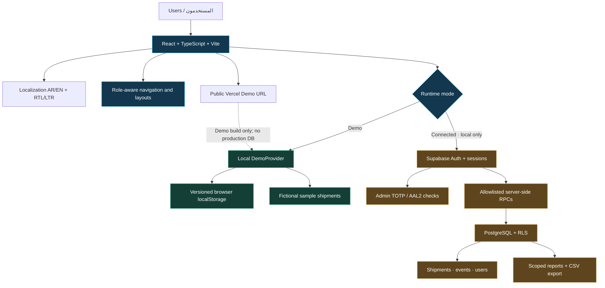
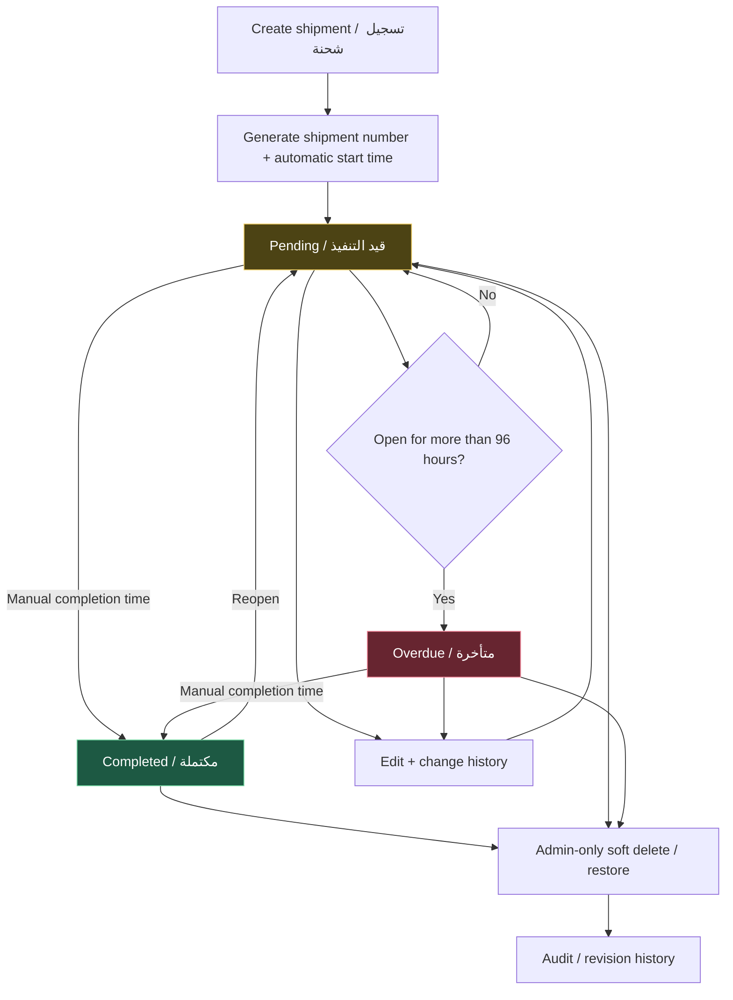
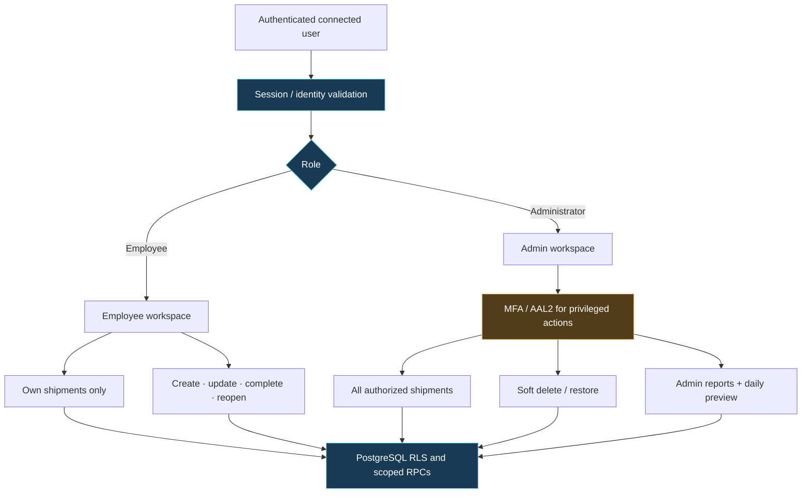
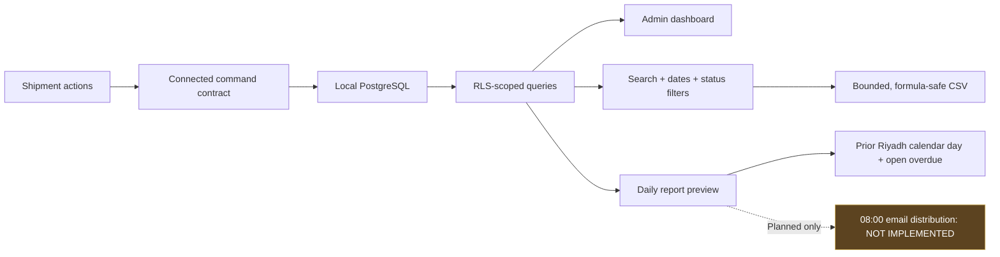

# Vision & Solution TMS — Architecture & Workflow Atlas

> **Documentation scope:** This atlas describes the approved `main` application baseline and distinguishes it from proposed work and the unmerged mobile UI candidate. It is not evidence of production security certification. Last documentation refresh: 10 November 2026.

## 01 · System architecture / بنية النظام

**Boundary:** The publicly hosted site is the **browser-local Demo build**, not the local Connected environment. The Connected path requires an independently configured local Supabase instance. No production database, authentication, or scheduling is attached to the public demo.

## 02 · End-to-end shipment lifecycle / دورة الشحنة

**Rules:** Timezone `Asia/Riyadh`. The overdue threshold is **strictly greater than 96 hours**, not exactly 96 hours. Reopening preserves the original start time. Server authority is enforced in Connected Mode; Demo Mode simulates the workflow locally.

## 03 · Roles, access and security / الصلاحيات والأمان

**Important:** This diagram describes the **local Connected Mode** tested with signed requests and RLS checks. In public Demo Mode, role selection is for demonstration and does not constitute production-grade authorization. Authentication, user provisioning and production hardening are not claimed for the Vercel demo.

## 04 · Data, reporting and operational visibility

**Known controls:** Connected CSV export is limited to **1,000 matching rows** and escapes spreadsheet-formula interpretation. The daily report is a **preview only**; no email is automatically sent.

## 05 · Delivery and roadmap / حالة التنفيذ

```mermaid
flowchart LR
  P1["Phase 1–2.9\nUI/UX + Demo baseline"] --> P2["Phase 3A–3B\nConnected foundations"]
  P2 --> P3["Phase 3C.1–3C.5\nAuth, RLS, commands, reports"]
  P3 --> REVIEW["PR #15\nMobile readability review"]
  REVIEW -. "Requires owner approval" .-> FUT["Future production preparation"]
  FUT -. "Not done" .-> PROD["Cloud DB, security acceptance, production release"]
  classDef complete fill:#17523f,color:#fff,stroke:#68d3a4;
  classDef review fill:#654b21,color:#fff,stroke:#efc672;
  classDef future fill:#303a4b,color:#fff,stroke:#9baaba;
  class P1,P2,P3 complete;
  class REVIEW review;
  class FUT,PROD future;
```

| Area | Status at documented checkpoint | Boundary |
|---|---|---|
| Bilingual responsive Demo UI | Implemented | Public preview runs on browser-local fictional data |
| Local connected Auth + protected roles | Implemented and locally tested | Not enabled on public demo |
| Shipment commands, audit trail and RLS | Implemented and locally tested | Local Supabase/PostgreSQL only |
| Operational reports and export | Implemented and locally tested | Admin privileges and RLS scope |
| Daily consolidated report | Preview implemented | **No scheduled delivery/email** |
| Mobile-first Connected enhancements | Draft PR #15 candidate | **Unmerged; visual approval pending** |
| Invoice image upload | Not completed | Do not claim live uploads |
| Production database and hardened release | Not completed | Requires separate review and authorization |
| Public website/production TMS integration | Not completed | Marketing site remains separate |

## 06 · Quality and acceptance snapshot

At the 29 Oct 2026 **local** acceptance checkpoint for the PR #15 mobile candidate, recorded results were: **74 application**, **30 security**, **13 authentication**, **20 database**, and **20 workflow** passing tests. Verification also covered Arabic/English, light/dark, mobile and desktop viewport combinations, and code/build checks. These are historical recorded local results — **not** a live CI status badge, external penetration test, or production approval.

## Source of truth

- [Central project status](PROJECT_STATUS.md) — approvals, branches, pending work and checkpoints.
- [Product boundaries](../PRODUCT.md) — intended capabilities and exclusions.
- [Agent / Git workflow](../AGENTS.md) — safety and preservation rules.
- [Connected workflow acceptance](phase-3c5-connected-workflow-acceptance.md) — implementation and verified workflow cases.
- [Mobile UI verification](mobile-first-connected-ui-verification.md) — draft candidate status and local tests.

**Note:** This atlas is documentation only. Diagrams intentionally avoid implying that local backend features are accessible from the public Vercel Demo.
