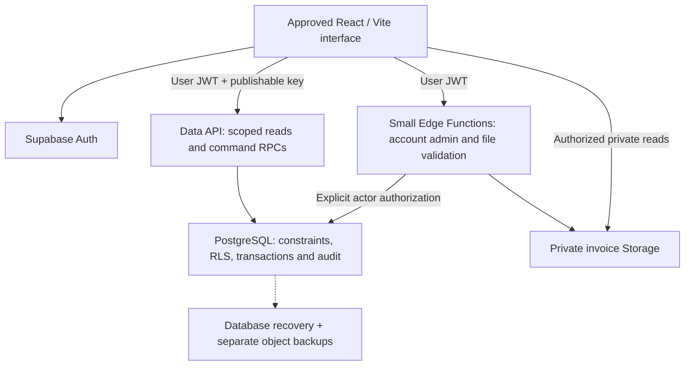

# Phase 3A — centralized shipment system architecture proposal

**Status: approved technical baseline.** Prepared 2026-10-27 against the approved Phase 2.9 frontend and approved by the user before merging PR #4. The user has now authorized the isolated [Phase 3B local database foundation](phase-3b-database-foundation.md). Production provisioning, application connection, credentials, scheduled jobs and deployment remain separately gated. The proposal below records the original architecture recommendations; this document itself creates no services.

## Approved baseline and merge evidence

Phase 2.9 [PR #3](https://github.com/a7mdel5taeeb-eng/vision-solution-shipment-system/pull/3) was explicitly approved and merged into `main` on 2026-10-27. Verified PR head: `7acfca4fb419642038cc61aff89b0c55b58d733d`. Merge commit: **`d593ab7ae27651409430746b9817a794e31c7d55`**. GitHub reported the PR merged, and clean local `main` was fast-forwarded to the same commit. The approved head is an ancestor of remote `main`.

Before merging, `npm run check` passed formatting, lint, **36/36 automated tests**, TypeScript and the production build. The reviewed diff contained the expected 11 accessibility, validation, typography, test and documentation files, with no dependency or lockfile change. Diff checks and a credential-pattern scan found no unintended files or apparent secrets. These checks are not a certification of production security.

The frontend is the approved baseline: official branding, Admin/Employee landing page, distinct dashboards, shipment workflows, Arabic/English and RTL/LTR, mobile layouts, focus and validation behavior, status text/icons, and Impeccable's pinned code-first configuration. Preserve React 19, TypeScript, Vite and Tailwind. Authentication screens and asynchronous loading/conflict feedback will require focused additions during approved implementation; no major redesign is proposed.

## Recommendation and system boundary

Use **one Supabase project for the company's production application**, with managed PostgreSQL, Supabase Auth and private Storage. Use an independent development/staging project with fictional data. This is a single-company application; avoid premature multi-tenancy, an ORM, a separate general-purpose API server, or a framework migration.

Use Postgres RPCs for atomic shipment commands; reserve Edge Functions for privileged Auth administration and processing file bytes. Ordinary shipment writes should use the user's identity, not an all-access secret. Supabase's [React Auth quickstart](https://supabase.com/docs/guides/auth/quickstarts/react) supports integration with the existing frontend. The design below is a project recommendation based on the current code and provider documentation, not a ready-made Supabase schema.

GitHub remains the source of truth for source code, reviewed SQL migrations, tests and runbooks. Supabase becomes the authority for live operational data and authenticated identity. Operational records, database dumps and credentials must never be stored in GitHub. Both Windows computers use the same committed source and, eventually, the same authorized central environment; cloning alone does not transfer today's browser data.

## Authentication and roles

- Use invite-only email/password accounts initially. Disable public signup and anonymous sign-in. An administrator invites employees through a protected server function; email ownership verification and password recovery require a separately approved production SMTP service. Supabase's default mail service is restricted and unsuitable for production: [custom SMTP guidance](https://supabase.com/docs/guides/auth/auth-smtp).
- Use the immutable `auth.users.id` UUID as the identity. Store display names in `profiles` and authoritative `admin`/`employee` plus `active` in a protected private access table. Never authorize from user-editable metadata, a selected role, a URL, or an employee ID supplied by the browser.
- The first administrator is bootstrapped through a reviewed, one-time operator procedure. Subsequent account changes require an active administrator, audit entry and protection against self-demotion/deactivation and loss of the last active administrator. Serialize these changes under a common transaction lock so concurrent administrators cannot both remove the last administrator. Disable rather than delete accounts so historical ownership remains intact.
- Require TOTP MFA for administrators. Enforce verified `aal2` in database policies, command functions and privileged Edge Functions; frontend redirects alone are insufficient. Allow only the minimum profile lookup needed for MFA enrollment before `aal2`. Define a verified operator recovery procedure for a lost factor. Employee MFA can be enabled later. See [Supabase MFA enforcement](https://supabase.com/docs/guides/auth/auth-mfa).
- Check the current access table on every protected request, so deactivation or demotion takes effect even with an unexpired JWT. Revoke refresh sessions when disabling an account. Logout clears in-memory/query caches and ends the Auth session; local theme/language preferences remain.
- Retain the approved role-selection landing page. In demo mode it continues to select fictional users. In production its role choices lead to sign-in and never assign permissions; the server-resolved role controls the destination. No production route may fall back to demo data or accept the demo identity keys.

Only a project URL and **publishable** API key belong in future browser configuration. Every `VITE_*` value is public. Secret keys, legacy service-role keys, database passwords and SMTP credentials stay in server secret storage. Elevated keys bypass RLS and require independent authorization in privileged code: [official API-key guidance](https://supabase.com/docs/guides/getting-started/api-keys). No values are requested or configured by this proposal.

The SPA's session tokens remain sensitive even when managed by the Auth SDK. Use HTTPS, approved redirect origins, a tested Content Security Policy and safe React rendering; never render shipment text as raw HTML or log tokens. Rate-limit sign-in, recovery and privileged endpoints. Treat browser XSS as a session-compromise risk; RLS enforces user boundaries but cannot prevent an attacker acting through a stolen valid session.

## Proposed tables and relationships

Use UUID primary keys, `timestamptz` UTC instants, explicit foreign keys, bounded text and checked workflow values. Below are logical shapes, not executable migrations.

| Table                          | Main fields and relationships                                                                                                                                                                                                                  | Purpose and write authority                                                                                     |
| ------------------------------ | ---------------------------------------------------------------------------------------------------------------------------------------------------------------------------------------------------------------------------------------------- | --------------------------------------------------------------------------------------------------------------- |
| `profiles`                     | `id` PK/FK to `auth.users`, `name`, optional `name_ar`, timestamps                                                                                                                                                                             | Display identity. Restricted name-edit command; email remains managed by Auth.                                  |
| `app_private.account_access`   | `user_id` PK/FK to profile, `role`, `active`, revision                                                                                                                                                                                         | Protected role authority; no direct browser table access. Admin-only commands change it.                        |
| `shipments`                    | UUID `id`, unique bigint `number`, `owner_id` FK, customer/origin/destination/truck/driver/cargo, nullable `driver_phone`, `invoice_number`, notes, `started_at`, workflow, `completed_at`, `deleted_at`, `deleted_by`, `updated_at`, revision | Current shipment state, written only by controlled commands. No cascading account deletion.                     |
| `shipment_events`              | UUID, shipment FK, actor FK, server `occurred_at`, action, revision, changed field names, permitted completion details                                                                                                                         | Append-only transactional business history. Index `(shipment_id, revision)` uniquely.                           |
| `invoice_files`                | UUID, shipment FK, unique generated object key, detected MIME, byte size, checksum, uploader FK, timestamps, lifecycle state                                                                                                                   | Optional file metadata: pending/available/rejected/retired. At most one current available invoice per shipment. |
| `report_recipients`            | UUID, normalized unique email, enabled, timestamps                                                                                                                                                                                             | Administrator settings; maximum 20 active recipients as today. No email is sent merely by saving.               |
| `admin_events`                 | UUID, actor, target, action, server timestamp, restricted details                                                                                                                                                                              | Role, account and recipient administration audit; administrator-only reads.                                     |
| `app_private.command_receipts` | actor FK, client request UUID, operation, payload fingerprint, result reference, timestamp; unique actor/request pair                                                                                                                          | Retry idempotency; inaccessible directly to browsers.                                                           |

Keep truck, driver, customer and cargo as shipment snapshots. A driver directory, fleet tables and accounting tables are outside scope. Store a phone as nullable **text**, preserving formatting and Arabic/Persian digits under the existing validation contract; never numeric or an identity key. A derived safe `tel:` value may be generated for display. Do not require a Saudi-only format or external number-verification service.

Match current six required text fields and 200-character trimmed limits, optional invoice number up to 100 characters, notes up to 2,000, and optional phone rules. Blank optional values map consistently to null and back to the UI's empty strings. Preserve Unicode and current search behavior for Arabic and English; do not translate user-entered data automatically or import fictional bilingual seed fields as real master data.

Add owner/start and owner/deletion indexes, a partial index on `started_at` for non-deleted open shipments, completion/start indexes for reports, and attachment/event foreign-key indexes. Begin with indexed filters and bounded search; add specialized search indexes only after query measurements. Use stable ordering with a unique tiebreaker and server pagination.

Reserve `report_runs` and `email_outbox` (unique reporting day/recipient keys, attempts, status, provider ID) for separately approved delivery work. Import manifests/batches are needed only if a real-data import is approved. Do not create empty future systems just because they appear in this proposal.

## Authorization and RLS contract

Enable default-deny RLS on all application tables, including private ones, and explicitly restrict schema/table/function grants. `anon`, expired tokens and inactive profiles receive no operational data. Protect every API surface, including counts, search, exports, files and audit joins. A hidden navigation link is not authorization.

| Resource/action                                                | Active Employee                    | Active Administrator with MFA                                                    |
| -------------------------------------------------------------- | ---------------------------------- | -------------------------------------------------------------------------------- |
| Read shipments, related history and available invoices         | Own, non-deleted shipments only    | All shipments, including deleted records                                         |
| Create shipment                                                | Owner forced to authenticated self | Owner forced to authenticated self initially; assignment needs separate approval |
| Edit / complete / reopen                                       | Own, non-deleted shipment          | Any non-deleted shipment                                                         |
| Delete / restore                                               | Denied, including own shipment     | Controlled soft-delete / restore commands only                                   |
| Profiles                                                       | Own display profile                | Employee management and display profiles                                         |
| Roles, account activation, recipients, admin reports and audit | Denied                             | Explicit administrator commands / scoped reads                                   |
| Direct table insert/update/delete                              | Denied                             | Denied; commands remain mandatory                                                |
| Alter audit events, owner, number or original start            | Denied                             | Denied through normal application commands                                       |

**Reads:** expose only selected tables/views through the Data API. Shipment policies require active identity and `owner_id = auth.uid()` for employees, or verified administrator access. History and file policies join the authorized parent shipment, including deletion state. Keep role helpers in an unexposed schema, bound to `auth.uid()` with no arbitrary subject parameter. Their limited elevated reads must avoid recursive profile RLS; test them independently. Do not expose the private access/receipt tables through PostgREST. Exposed views must use `security_invoker = true` or have equivalent explicit protection: [RLS documentation](https://supabase.com/docs/guides/database/postgres/row-level-security).

**Writes:** revoke direct DML from browser roles and expose a small command API. `SECURITY INVOKER` cannot write through revoked table grants, so mutations need deliberately reviewed `SECURITY DEFINER` functions. Own them with a dedicated non-login writer that is neither table owner, superuser nor `BYPASSRLS`; grant only required table/sequence privileges and writer-specific RLS policies enforcing the same actor/ownership rules. Browser roles must not inherit that role. Keep table ownership with the migration role.

Each function must additionally check `auth.uid()`, current active access, MFA where required, ownership, deletion state and permitted fields. Use an empty fixed `search_path`, schema-qualified objects, no dynamic SQL, no arbitrary actor/owner parameter, and no browser-settable session flag that bypasses validation. Revoke default execution from `PUBLIC` and `anon`; grant only named entry points to `authenticated`. Private helpers get only necessary grants. Supabase warns that definer functions created as `postgres` can bypass RLS; avoid that runtime ownership: [function security and privileges](https://supabase.com/docs/guides/database/functions).

Policies for the writer role must evaluate JWT identity rather than `current_user` (which is the definer). Review both `USING` and `WITH CHECK`, restrictive MFA rules, and all helper owners/grants. Privileged Auth/file functions must validate the user's signed token and access before invoking secret-key operations; a secret key cannot substitute for user authorization.

## Secure commands, time and concurrency

Recommended operations: create, update allowed fields, complete, edit completion, reopen, soft delete, restore, reserve/finalize/retire invoice, and restricted account/recipient changes. Return typed validation, forbidden/not-found, conflict and retryable-service errors, translated by the existing catalogs. Do not reveal another employee's record existence in error details.

1. Receive the authenticated identity, a client request UUID, expected revision for edits, and only operation-specific fields. Validate types, lengths, Unicode/phone rules and allowed fields on the server.
2. Lock the current row for edits and compare the expected revision; a stale edit returns a conflict without changing anything. Retain unsaved form values and offer reload/reconciliation; never silently overwrite a colleague's edit.
3. Apply one authorized transaction: mutate shipment, increment revision, append the event and store the command receipt. An audit failure rolls back the mutation. Repeated request UUIDs with the same operation/payload return the prior result; reuse with a different payload is rejected.

Generate internal UUIDs and a database sequence-backed unique bigint display number, rendered as `TR-0001` with a minimum of four digits, expanding naturally. Concurrent inserts use the sequence, never `MAX(number)+1` or a browser counter. Gaps after rollbacks are acceptable; numbers are never reused. Serialize bigint identifiers safely as strings across JavaScript boundaries.

Creation assigns `owner_id` and original `started_at` on the server at save, with pending workflow. Owner, number and start remain immutable. Completion is manually entered as Riyadh local time, converted to a UTC instant and validated server-side between start and current server time. Constraints enforce pending ⇒ null completion and completed ⇒ valid completion ≥ start. Reopening clears completion and retains the original start; no employee may delete, restore or reassign a record.

Derive status using server time: completed if completed; otherwise overdue only when **`server_now > started_at + 96 hours`**; otherwise pending. Exactly 96 hours is pending. Soft-deleted rows are excluded from active queries. Do not store an independently editable overdue flag or rely on a cron job to change it. Return a server-time reference for the existing 30-second UI refresh; the computer clock is not authoritative.

Reports, counts and CSV export must use authorized server queries over the complete filtered dataset, not only the visible page. Preserve Riyadh calendar-day filters and existing daily-preview semantics, including the latest effective completion retained in history after reopening. Keep formula-safe CSV generation. A future consolidated digest is for 08:00 Asia/Riyadh (05:00 UTC), previous-day activity plus all currently open overdue shipments; scheduling and real delivery require separate approval.

## Optional private invoice storage

Use a **private** invoice bucket, with no public object URLs. Preserve current PNG/JPEG/WebP types and 750 KiB byte limit; invoice number and attachment remain independent and optional. Do not add PDF support in this phase. Storage uses RLS separately from application-table RLS: [Storage access control](https://supabase.com/docs/guides/storage/security/access-control).

Recommended flow: authorize/reserve a generated object key against the shipment, upload through an authenticated Edge Function, validate actual bytes/signature and decoded image dimensions, then publish metadata as available only after validation succeeds. MIME headers and filename extensions are insufficient. Bound payload size, reject malformed/decompression-bomb images, and evaluate malicious-content scanning or safe re-encoding before rollout. Keep uploads private and unavailable while pending; any scanning service would require separate dependency/service approval.

Scope Storage object reads to an available metadata row whose parent is accessible to the current actor. Deny browser overwrite, move, arbitrary listing and physical deletion. Generated UUID paths and a checksum avoid collisions; paths alone do not prove ownership. A replacement gets a new key, then atomically changes the current attachment reference and records history. Objects and SQL cannot share one transaction: use explicit pending states, finalize checks and a retryable orphan-cleanup process.

Prefer authenticated downloads. If signed URLs are needed, authorize issuance and expire them quickly (for example 60 seconds); an already issued link may remain usable until expiry after deletion or deactivation. Soft deletion removes fresh access. Retiring an attachment is a logical audited change; physical purge requires an approved retention policy and must account for backup recovery. Never put full signed URLs, raw phone numbers or image data in general logs.

## Audit, privacy and recovery

Append creation, field changes, completion/edit, reopen, delete/restore and invoice changes with server time, real actor, revision and relevant completion details. Clients cannot write or edit history. Preserve enough completion history for the approved daily report without storing unnecessary full snapshots of personal data. Use a separate restricted audit for account/role/recipient administration. Record authorized imports as imports with provenance, never fabricate old entries as server-verified actions. Database operators can still alter data; this is application-enforced history, not cryptographic tamper-proof evidence.

Recommend Supabase Pro for production. It includes daily database backups with seven-day retention. Database backups **do not include Storage object bytes**. PITR is an optional paid alternative to daily backups, requires at least Small compute, and can provide much finer recovery points. These distinctions follow [Supabase backup documentation](https://supabase.com/docs/guides/platform/backups).

Proposed initial recovery targets, requiring business acceptance: **RPO up to 24 hours** for database and files with coordinated daily backups; **RTO target 4 hours**, to be measured by restore drills rather than promised as a provider SLA. If losing a day's registrations is unacceptable, approve PITR and a correspondingly stronger file-backup strategy before launch.

Maintain encrypted off-site logical exports and separate versioned invoice-object copies/manifests in an approved restricted backup destination. Initial suggested retention is 30 days for independent backups, subject to company policy. Include database roles/grants, schema, Auth recovery requirements and configuration references in the runbook; secrets stay in a password manager. Verify restored identities still map to profiles/owners, attachments match checksums, sequence allocation exceeds existing numbers, and access controls survive recovery.

Before launch and periodically afterward, rehearse restore into an isolated project, reconcile files against metadata, test RLS and login, then record elapsed time and restore point. A production restore requires approval and a maintenance window; freeze writes, preserve the current state, restore, validate and reconcile later activity. Do not restore blindly over newer valid work. Monitor failed backups, unauthorized requests, command errors, storage growth and database capacity without logging shipment payloads.

Select an exact project region only after company data-location requirements and home/school latency testing are reviewed. Frankfurt and Mumbai are candidates to measure; the currently published list does not include a Saudi region. Region selection alone does not establish regulatory compliance: [available regions](https://supabase.com/docs/guides/platform/regions). Retention, recovery targets and residency remain launch decisions.

## Safe handling of current browser data

Default production bootstrap is **empty operational tables plus explicitly provisioned real accounts**. Do not upload the 32 fictional seed shipments, demo users, or local recipients. Browser `vs.prototype.v2` data is untrusted, tied to an origin/profile and can contain overlapping `TR-*` numbers across machines.

If the company later identifies real records worth retaining:

1. Explicitly authorize each source/browser export; preserve original local storage and an encrypted backup outside Git. Never clear or rewrite it automatically.
2. Dry-run validate schema, timestamps, fields, phones, image bytes and ownership mappings against invited real Auth UUIDs. Reject missing owners, corrupt data and ambiguous duplicates; preview a reconciliation report for approval.
3. Allocate new central IDs/numbers. Preserve old IDs in a restricted import mapping, not as globally trusted identifiers. Use source fingerprint/batch/row keys to make retry safe. Imported starts require a dedicated operator-only path, never the normal create endpoint.
4. Import only approved rows into staging first, label legacy history as unverified provenance, validate totals/workflows/time boundaries, and obtain cutover acceptance. For production, freeze legacy writes, import transactionally in bounded batches, reconcile attachments and counts, then switch the environment deliberately.
5. Keep source exports and mappings under an agreed retention period. Rollback requires an approved reconciliation plan; once central edits exist, do not fall back to a stale local snapshot or delete imported rows automatically.

## Integrating with the approved React application

Keep `model.ts`, typed messages, date helpers, tokens and presentational components as the behavior contract. Current `src/app/demo/` remains an isolated demo adapter. Introduce an asynchronous repository/session boundary for production reads and commands; replace synchronous `execute(): boolean` assumptions with awaited typed results and server-returned records. The production provider must not load the entire company's state into every browser.

Plan separate profile/session, paginated shipment, detail/history, statistics/report and recipient operations. Generate database TypeScript types from reviewed migrations; explicitly map snake_case/null/UUID/number formats to current view models. Add the official Supabase JS client and test tooling only during separately approved implementation, after dependency review. No additional package is installed now.

Preserve validation focus, accessible error associations, mobile controls, Arabic/English copy and RTL. Add loading, expired-session, offline and revision-conflict states without changing the layout baseline. Prefer pessimistic shipment saves initially, disable duplicate submissions and retain form contents on failure. Cancel/clear requests and caches on role/session change so one user's data cannot flash for another. Do not persist shipment payloads in localStorage or implement offline write replay initially.

Use query invalidation after successful commands, refresh on focus and modest polling for operational status. Defer Realtime until a demonstrated need; if added, authorize channels and invalidate/refetch rather than trust client events. Server pagination, filters, counts and exports must remain consistent. Browser-local language/theme preferences are safe to retain.

## Monthly operating estimate

Planning assumptions: one company, approximately 5–25 staff, modest concurrency, up to 1,000 new shipments/month, at most one invoice per shipment and most much smaller than 750 KiB. Worst case 12,000 attachments of 750 KiB is about **8.6 GiB/year** before backups/retired versions. This is a sizing assumption, not a measured workload.

USD estimates checked against official sources on **2026-10-27**, before tax, overages and exchange charges. [Supabase pricing](https://supabase.com/pricing) lists Pro at $25/month with $10 compute credit, covering one Micro. Included allowances list 8 GB database/project, 100 GB file storage, 250 GB egress and 100,000 monthly active users. These are shared-plan allowances where applicable, not unlimited usage. Free projects can pause after inactivity, so Free is for disposable development, not the operational baseline.

| Scenario                                                                | Calculation                                            | Estimated Supabase monthly total |
| ----------------------------------------------------------------------- | ------------------------------------------------------ | -------------------------------- |
| One production Micro                                                    | $25 plan + about $10 compute − $10 credit              | **$25**                          |
| Production Micro + separate Micro staging in the same paid organization | $25 + $10 + $10 − $10                                  | **$35**                          |
| Production Small + 7-day PITR                                           | $25 + about $15 compute − $10 credit + about $100 PITR | **$130**                         |
| Small production with PITR + Micro staging                              | Prior row + about $10 staging compute                  | **$140**                         |

PITR's Small minimum is included above; simply adding $100 to the Micro estimate understates cost. Compute is hourly and is not covered by the spend cap: [compute pricing](https://supabase.com/docs/guides/platform/manage-your-usage/compute). Recovery add-on rates are in the [backup pricing table](https://supabase.com/docs/guides/platform/backups). Additional organizations, larger compute or excess usage change these totals.

Allow a provisional **$10–30/month contingency** for external SMTP and independent file backups; this is a budget allowance, not a vendor quote. A practical initial operating budget is therefore **$45–65/month** for production plus paid staging, excluding frontend hosting, domains and optional scanning. Hosting remains unselected and separately approved. PITR raises that planning range to about **$150–170/month**. Re-price SMTP, backup storage, hosting and all provider allowances at implementation approval; future consolidated-report delivery is not enabled by this budget.

Start with Micro production plus isolated staging if the business accepts daily recovery. Enable usage alerts, retain supported spend controls, and review actual invoices and growth monthly. Avoid custom database domains, paid IPv4, enterprise SSO, SMS MFA, and extra projects unless a verified need justifies them. Pro plan pricing is an operating estimate, not authorization to purchase.

## Implementation sequence and acceptance gates

This branch contains documentation only. A later approved Phase 3A implementation should proceed in reviewable steps:

1. Confirm region, budget, real administrator roster, retention and RPO/RTO; approve dependencies/tooling and a development-only environment. Do not request production credentials as part of this proposal.
2. Implement reviewed SQL migrations, constraints, least-privilege grants, command functions and RLS against fictional data. Add database integration tests before connecting production UI.
3. Integrate Auth and the async repository behind the current components; retain the isolated demo and all 36 current regressions. Add invite/recovery/MFA and session handling tests.
4. Add and verify private invoice handling, audit, concurrency and report parity. Rehearse backups/restore and any separately approved legacy import.
5. Complete staging acceptance, document operational procedures and request separate production provisioning/deployment approval. Actual daily email scheduling/delivery is a distinct approval item.

Required evidence before production includes real JWT sessions for employee A/B, admin with/without MFA, disabled users and unauthenticated callers. Test direct Data API writes, function execution grants, metadata-role escalation, guessed UUIDs, parent/file/history isolation, deleted shipments and exports. Verify denied actions leave no mutation or audit artifact. Exercise simultaneous creates, duplicate retries, conflicting edits, attachment finalization failures, exactly-96-hour boundaries, Riyadh day boundaries, reopening/report history, and restored sequence/ownership state. Re-run keyboard, responsive, AR/EN and theme checks after integration; the existing tests alone do not prove RLS security.

**Phase 3B local database foundation is approved; production implementation and application connection require separate approval.** No paid project, provider account, production credential, public website change, deployment, SMTP delivery or scheduler is created by this proposal.
